# WAYLO

Team AlgoKnights, IntelliCon 2026

Need something from abroad? WAYLO finds someone who is already flying to your city. They buy it new, carry it, declare it at customs and hand it to you. You pay up front and the money waits in escrow. The traveller only gets paid when you give them a six digit code at the handover.

We are launching with India to Sri Lanka, but any route works.

## Live links

* **Live demo:** https://odcaum2ste.execute-api.ap-south-1.amazonaws.com
* **Landing page:** https://shageeshant.github.io/intellicon2026-AlgoKnights/

The live app runs in demo mode right now. The sign in code is shown on screen. Payments go through the escrow ledger without charging a card, so you can try the whole flow yourself.

## Key features

* Post exact items with a budget, reward and deadline, or browse travellers arriving in your city.
* Compare offers and pay into an escrow ledger.
* Track purchases with receipts, photos and a customs declaration sheet.
* Arrange a public meeting and release payment with a six digit handover code.
* Use chat with contact masking, identity checks, ratings and admin decisions on disputes.

## What works and what is mocked

### Fully working in the live demo

* Accounts, onboarding, trips, requests with live quote, browse arrivals.
* Offers, accept and pay into an escrow ledger, chat with contact masking.
* Item checklist with receipt and photo uploads, top ups and substitutes, customs declaration sheet.
* Meeting proposals, handover code and payout, ratings.
* Disputes and admin decisions, ID upload and admin review, held item review.
* Notifications, automatic deadlines, admin desk, demo data.

### Mocked in the demo

* Sign in code is shown on screen instead of SMS.
* Payments are recorded on the escrow ledger without charging a card.
* ID checks are reviewed by hand by an admin.
* Exchange rates are a fixed table.

### Being connected now (not live yet)

* Clerk for sign in with Google or an emailed code.
* Didit for automated ID checks.
* PayPal for real payments and refunds.
* Amazon S3 for files and backups.

## Tech stack

### Full app

* Next.js 16 with the App Router and server actions, React 19 and TypeScript in strict mode.
* Tailwind CSS 4.
* PostgreSQL 16 with Drizzle ORM and versioned SQL migrations.
* Embedded Postgres (PGlite) for local development and tests.
* AWS EC2 t4g.small in Mumbai, Ubuntu 24.04, Caddy for HTTPS and API Gateway in front.
* systemd timers for deadlines and nightly backups.

We run GitHub Actions on every push. It checks lint and types, then runs 17 workflow tests on in memory Postgres and again on PostgreSQL 16. It also runs a production build, a Chrome walkthrough of the whole order flow, Lighthouse budgets and a secret scan.

Every passing push to `main` deploys automatically. The pipeline signs in to AWS with OIDC and no stored keys. It opens SSH only for itself, backs up the database and switches the release. It rolls back automatically if the release is unhealthy. It also checks that the live site reports the pushed commit.

We have a manual rollback button and an uptime check every six hours. The check opens an issue if the site is down. We use Dependabot to keep packages up to date.

### This repo's landing page

The landing page is built with Next.js 16, TypeScript and Tailwind CSS 4. We use a static export to GitHub Pages.

Every push and pull request goes through the CI pipeline in [.github/workflows](.github/workflows). It runs lint and type checks, a production build and Lighthouse on the built site. The build fails if accessibility, best practices or SEO drop below 95 or if the layout shifts. CodeQL scans the code and the workflows. Dependabot keeps packages up to date.

Work happens on feature branches that merge into `dev` through pull requests. `dev` merges into `main` for a release. Only `main` deploys, after every check has passed. The files that go live are the exact build Lighthouse tested.

## Setup

### Run the landing page locally

From this repo's directory, run:

```sh
npm ci
npm run dev
```

### Try the full app

Open the live demo linked above. Sign in with any phone number. The code appears on screen. Enter that code to try the full app.


## About the source code

We were asked to share the full codebase so the panel can judge code quality. We understand why, but we can't publish it. We want to be upfront about the reason.

WAYLO isn't something we built for a weekend and will forget about. It's our startup. The app is built and running on AWS. We're close to launching it for real. The full app code is private and is not open source. Publishing it would let anyone walk off with the product we've spent weeks on.

So this repo has what we can share:

1. The landing page as real code, checked and deployed by a proper pipeline
2. Screenshots of the full product, including identity verification, escrow and the admin desk
3. A write up of how the whole system is built, in [docs/architecture.md](docs/architecture.md)

On code quality, please don't worry. The private codebase is written in strict TypeScript. We lint and type check it on every push. Automated tests cover the full order and escrow flow and must pass before deployment. Every passing push to `main` is deployed to AWS automatically.

If the panel wants to look at the code itself, we're happy to share our screen. We can walk you through any part of it. We just can't publish it.

## How it works

1. You post what you need: the exact items, the most you'll pay, a reward and a deadline. Or you browse travellers landing in your city in the next 3 days, week, two weeks, month or three months. You can send your request to one of them.
2. Travellers whose trip fits the route, the date and their spare luggage make offers.
3. You accept one and pay once into escrow: the item budget, the reward, a duty allowance and our 8% fee.
4. The traveller buys each item new, uploads the receipt and a photo, and declares everything at customs.
5. You meet in a public place, check the items and read out your code. The traveller is paid, and anything unspent comes back to you.

## Screenshots

### Asking for something

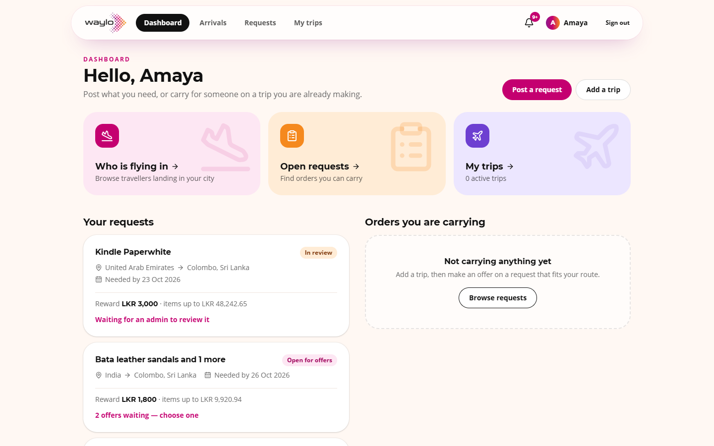

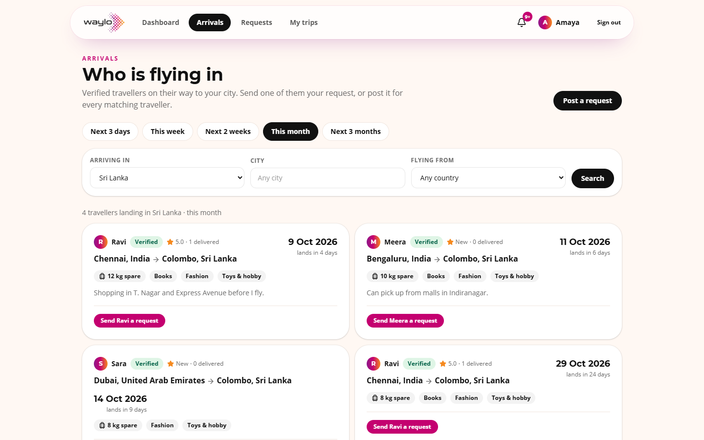

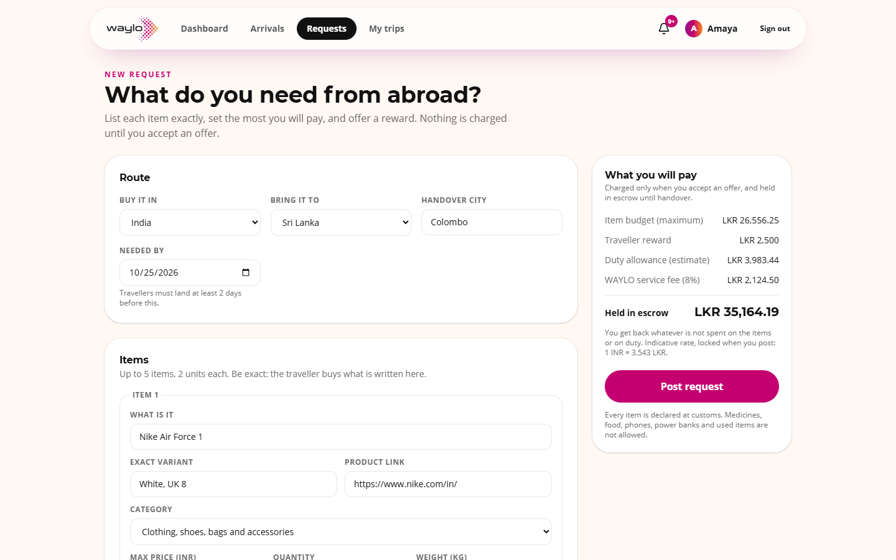

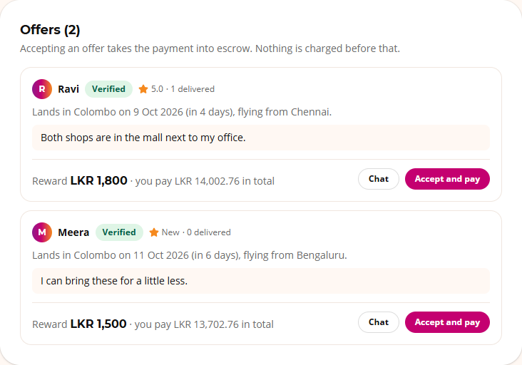

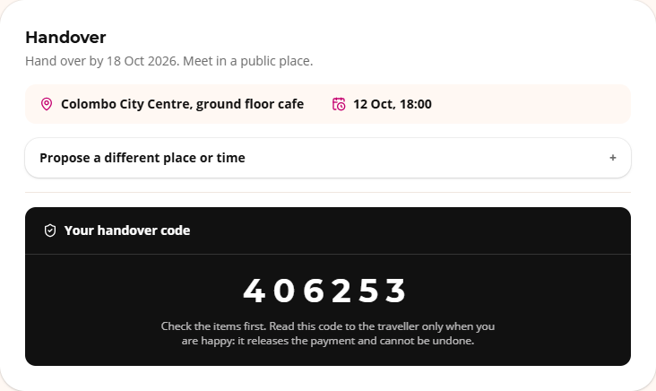

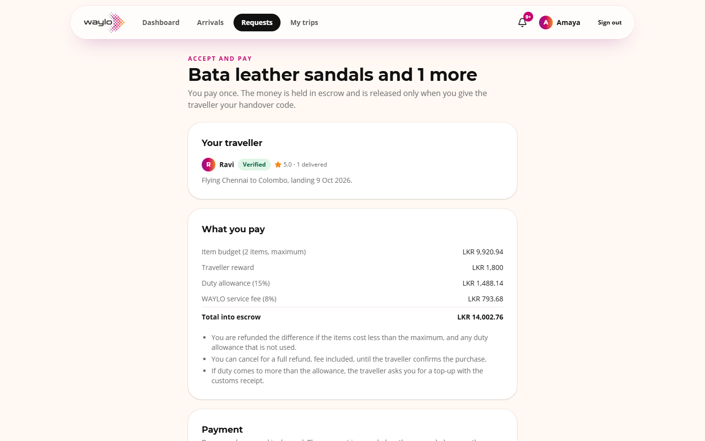

### Carrying it

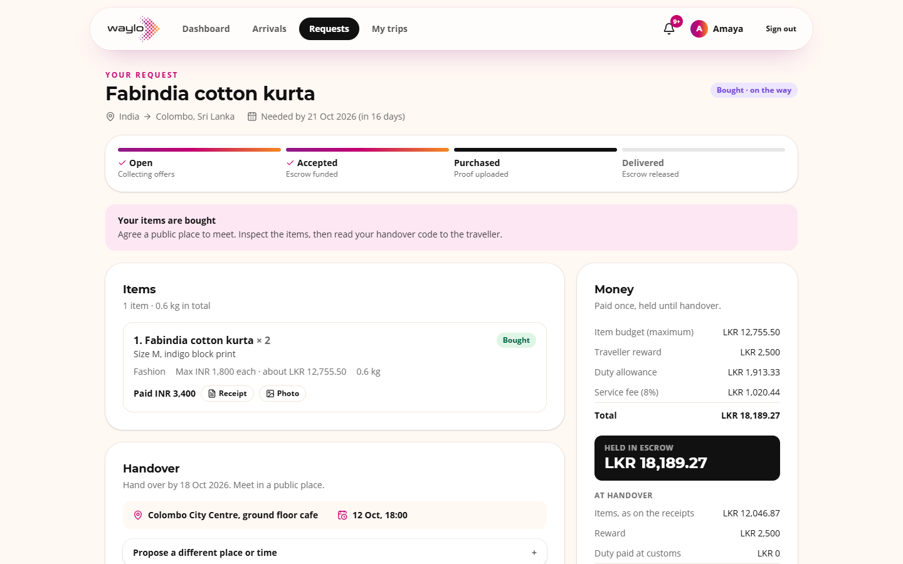

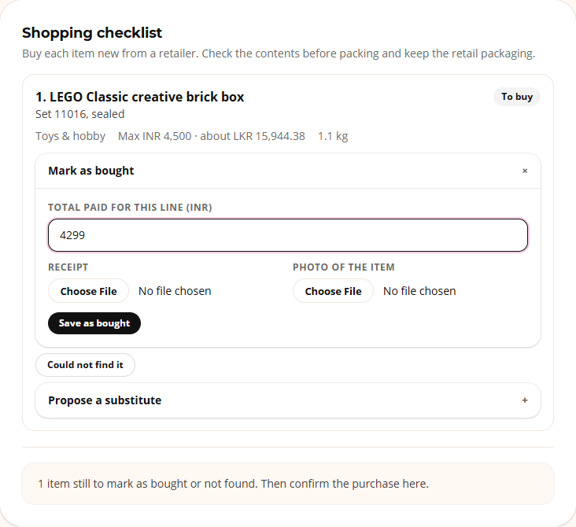

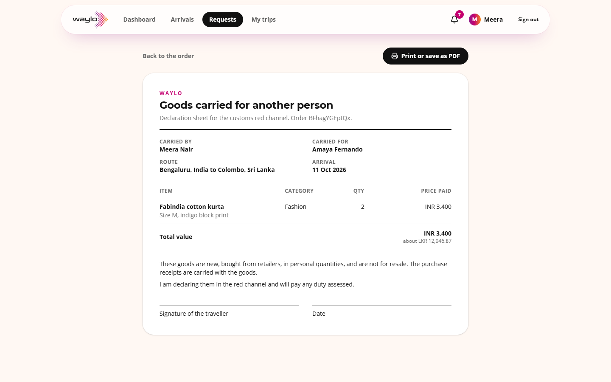

### Trust and safety

Phone numbers, emails and links are hidden in chat, so deals stay on the platform where escrow protects them.

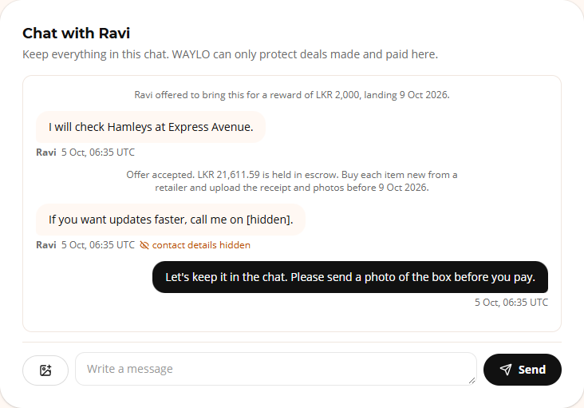

Everyone who pays or carries is verified first. They upload an ID and a selfie and an admin checks them. The ID and selfie below are drawn samples, not real people.

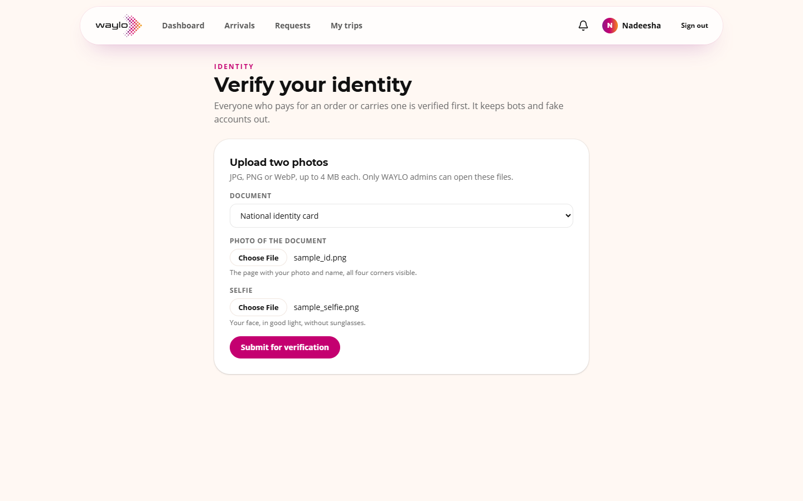

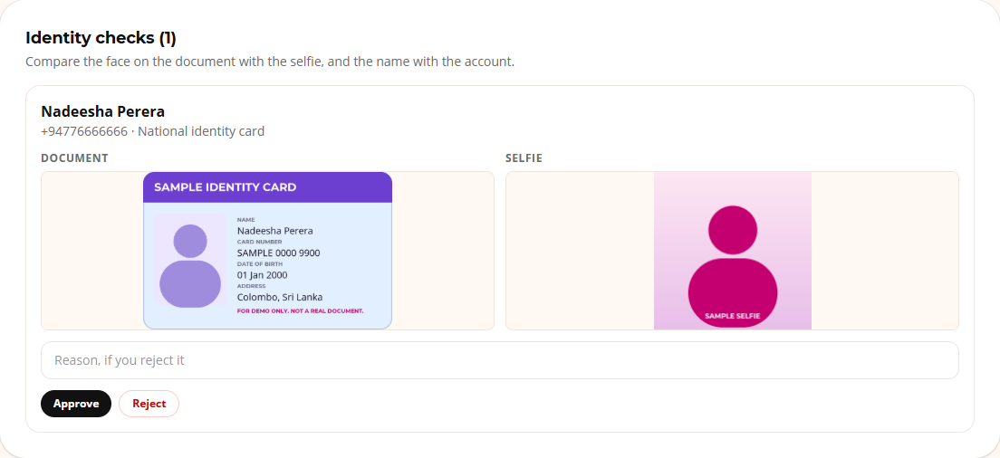

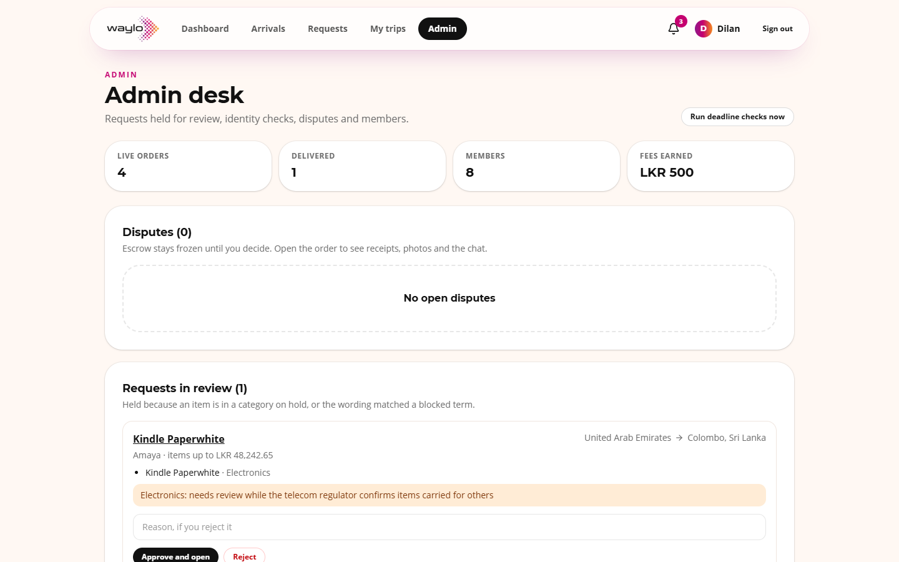

### On a phone

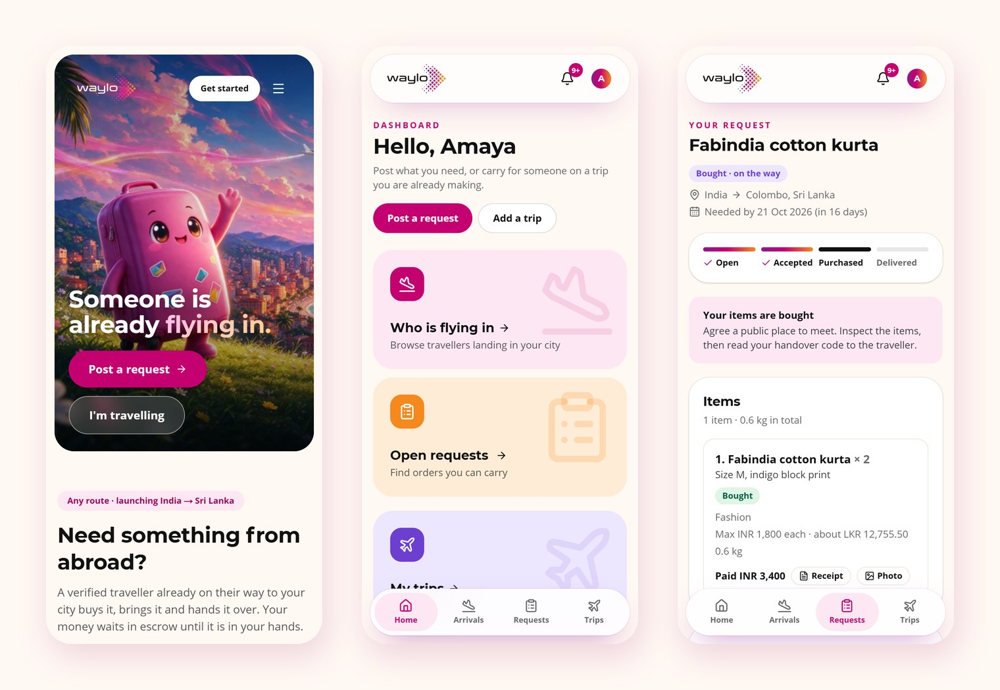

## License

All rights reserved. See [LICENSE](LICENSE).
